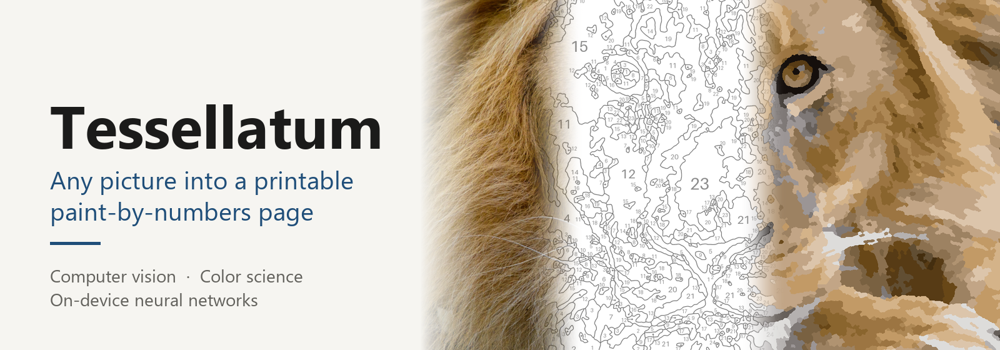
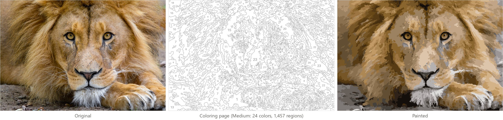
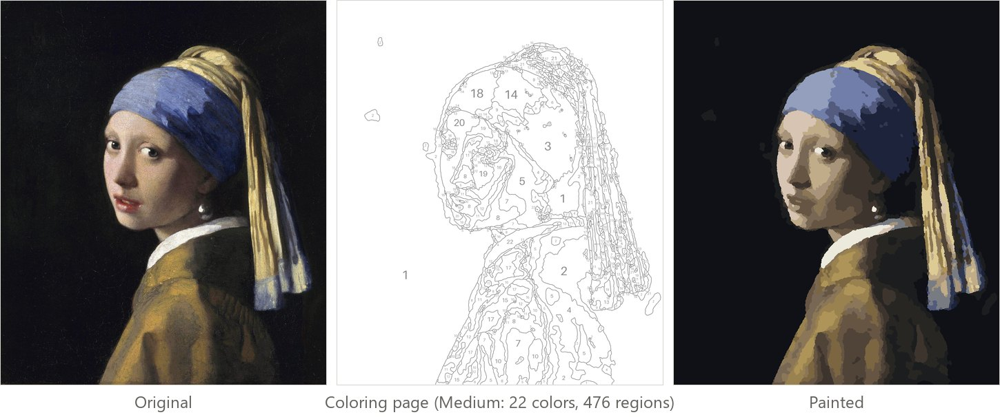
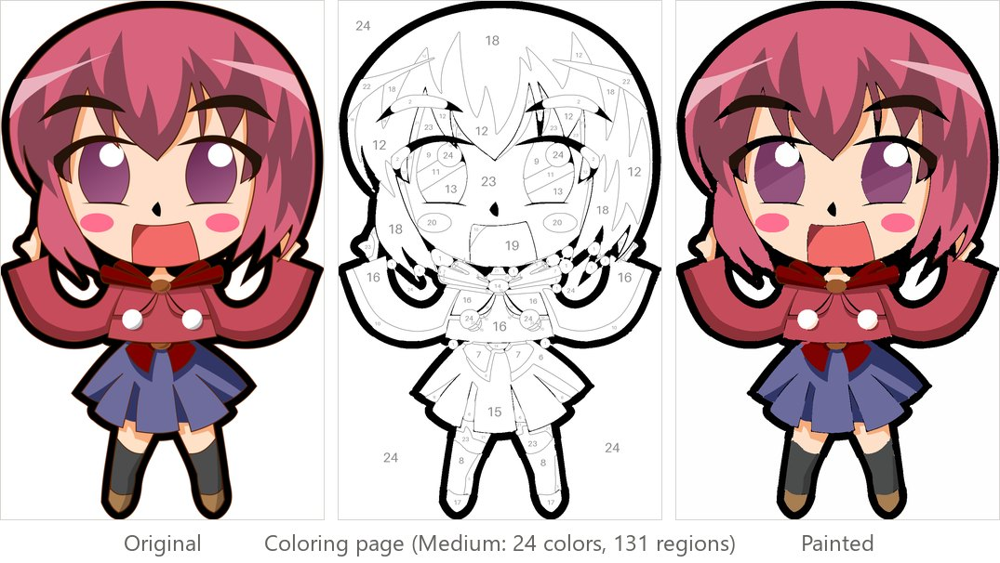
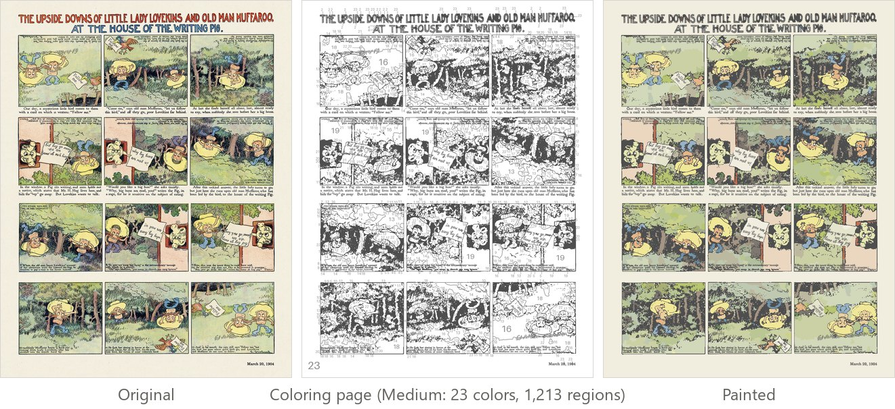
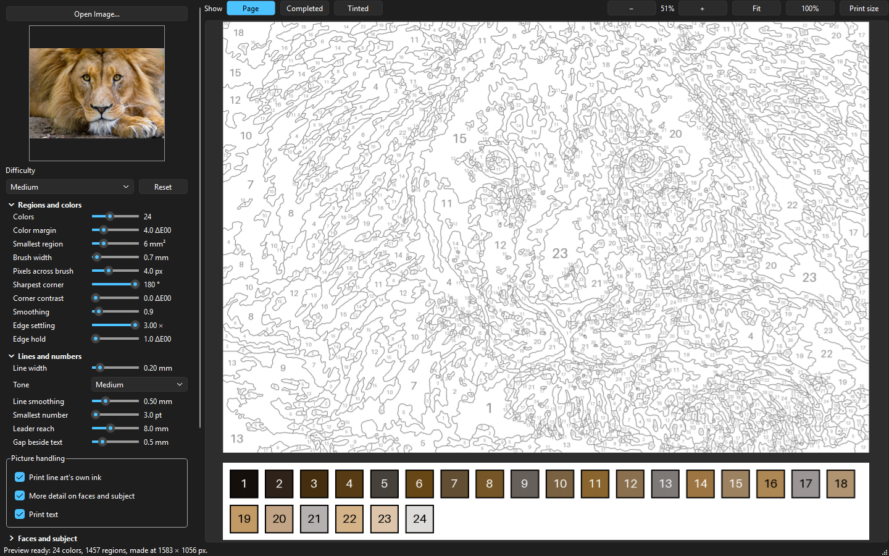
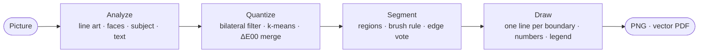

<p align="center">
  
</p>

<p align="center">
  <a href="https://github.com/maximshilo/tessellatum/releases/latest"></a>
  <a href="https://github.com/maximshilo/tessellatum/actions/workflows/tests.yml"></a>
  
  
  <a href="LICENSE"></a>
  <br>
  
  
  
  
  
  
</p>

**Tessellatum** turns any picture (a photograph, a painting, a cartoon or a comic) into a printable
paint-by-numbers page: flat, outlined regions, each with a number, and a matching color legend. It pairs classical
image analysis with compact neural networks that run entirely on-device, and holds every page to physical rules of
paintability on an A4 sheet: no region narrower than the brush, no number too small to read, no two colors too close
to tell apart.

## Gallery

**Photograph.** Fur and grass become smooth, brush-sized patches; the face and the subject get finer regions.


**Painting.** Face detection keeps the eyes, nose and mouth; skin settles into a few large tones.


**Cartoon.** The artwork's own ink lines are found and printed, and its fill colors become the palette.


**Comic.** Captions and signs are detected and printed as lettering; hatching is painted over.


More in the [gallery](https://github.com/maximshilo/tessellatum/wiki/Gallery). Example pictures are CC0 or public
domain ([sources](tests/sample_images/SOURCES.md)).

## The app



Pick a difficulty from Beginner to Realistic, or tune any of 22 settings; preview the page, its painted version and a
tinted painting guide; export a 300 dpi PNG or an A4 PDF of vector art.

## Highlights

**Machine learning**
- **Face detection:** YuNet convolutional network on OpenCV DNN, plus an LBP cascade for drawn faces, re-implemented
  and JIT-compiled.
- **Salient object segmentation:** U²-Net finds a picture's subject, so the detail goes where people look.
- **Scene text detection:** PP-OCR's Differentiable Binarization network on ONNX Runtime; lettering is traced at
  sub-pixel accuracy and printed as vector outlines.
- **Unsupervised learning:** k-means++ clustering in CIELAB for the palette; histogram-based color selection for line
  art.

**Image analysis**
- Edge-preserving bilateral filtering and perceptual color science (CIELAB, CIEDE2000).
- Mathematical morphology to detect ink lines, fine facial features and text backgrounds.
- Euclidean distance transforms and Voronoi partitioning to remove every region a brush can't paint.
- Connected-component labeling, contour tracing and polygon simplification.
- Color-weighted Gaussian voting that smooths texture edges while keeping real ones.
- Boundary extraction on the pixel-crack graph, constrained smoothing and supersampled anti-aliasing.

**Engineering**
- Interactive speed: Numba-compiled kernels and multithreading, a preview in about 1–3 seconds.
- Print output: 300 dpi PNG and a purpose-built vector PDF writer.
- Quality assurance: 1,200+ automated tests, including pixel-exact equivalence tests, and a benchmark harness that
  scores every version on speed and image quality (ΔE00, SSIM, OCR error rate, edge F1).
- Desktop delivery: cross-platform Qt 6 interface with background workers (Windows, macOS, Linux), standalone Windows
  build released by GitHub Actions.

## How it works



The stages, their parameters and the reasoning behind them are in the wiki:
[How it works](https://github.com/maximshilo/tessellatum/wiki/How-It-Works) and
[Techniques](https://github.com/maximshilo/tessellatum/wiki/Techniques).

## Getting started

**Windows:** download `Tessellatum-<version>-windows-x64.zip` from the
[latest release](https://github.com/maximshilo/tessellatum/releases/latest), unzip it anywhere and run
`Tessellatum.exe`. No installer, no Python needed.

**macOS and Linux:** run it from source, as below, or build a standalone app with `packaging/build_macos.sh` or
`packaging/build_linux.sh` ([details](https://github.com/maximshilo/tessellatum/wiki/Getting-Started)).

**From source** (Python 3.10+), on Windows:

```
git clone https://github.com/maximshilo/tessellatum.git
cd tessellatum
py -3 -m venv .venv
.venv\Scripts\pip install -e ".[dev]"
.venv\Scripts\python -m tessellatum.main
```

On macOS and Linux:

```
git clone https://github.com/maximshilo/tessellatum.git
cd tessellatum
python3 -m venv .venv
.venv/bin/pip install -e ".[dev]"
.venv/bin/python -m tessellatum.main
```

## Documentation

| | |
|---|---|
| [User guide](https://github.com/maximshilo/tessellatum/wiki/User-Guide) | Every setting, the difficulty levels, export formats |
| [How it works](https://github.com/maximshilo/tessellatum/wiki/How-It-Works) | The pipeline, stage by stage |
| [Techniques](https://github.com/maximshilo/tessellatum/wiki/Techniques) | The machine-learning and image-analysis methods used |
| [Architecture](https://github.com/maximshilo/tessellatum/wiki/Architecture) | Code organization, threading, caching |
| [Quality and performance](https://github.com/maximshilo/tessellatum/wiki/Quality-and-Performance) | How pages are measured, benchmark results, speed |
| [Development](https://github.com/maximshilo/tessellatum/wiki/Development) | Tests, benchmarks, building, releasing |
| [Changelog](CHANGELOG.md) | Release history |

## License

[Apache License 2.0](LICENSE). The bundled detection models are MIT or Apache 2.0 licensed
([details](src/tessellatum/resources/MODELS.md)).
