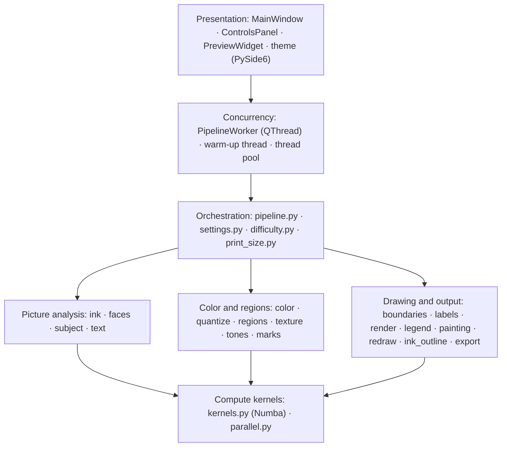

# Architecture

## Layers



The core (`src/tessellatum/core/`) never imports the GUI or Qt: the pipeline is a plain function of an image and three
settings objects, which is what lets the tests and the benchmark harness call it directly. All work runs off the UI
thread.

## Repository

```
src/tessellatum/
  main.py          entry point
  core/            the pipeline: 29 modules
  gui/             the Qt interface: 5 modules, and theme/ (tokens, style, icons, motion)
  resources/       the four bundled models and their licenses (MODELS.md); fonts/ (Inter, OFL) and icons/
                   (Lucide, ISC)
tests/             pytest suite and the benchmark images (CC0 / public domain)
benchmarks/        speed and quality harness, quality spec and report
packaging/         PyInstaller spec and build scripts
docs/              README images and the scripts that regenerate them
wiki/              these pages (published to the GitHub wiki on every push to main)
```

## Main modules

| Module | Role |
|---|---|
| `core/pipeline.py` | Orchestration: working size, stage cache, the full generation, drawing a page at print size |
| `core/settings.py`, `core/difficulty.py` | Every user setting with its range and default; the five presets |
| `core/print_size.py` | The print model: A4, A3 and A2 geometry, pixels per millimetre, unit conversions |
| `core/quantize.py`, `core/color.py` | Bilateral filter, k-means palette, CIEDE2000 merge, a palette from the painter's paints and the colors they mix; exact color conversion |
| `core/paints.py`, `core/paint_kits.py` | The painter's paints: read from text and from palette files; generic sample kits to start from |
| `core/mixing.py`, `spectral_data.py` | Mixing recipes and a palette's two-paint mixes by Kubelka-Munk theory over reflectance curves; spectral.js's data (MIT) |
| `core/ink.py`, `faces.py`, `subject.py`, `text.py` | Line-art decision and ink; the three detectors; lettering |
| `core/regions.py`, `texture.py`, `tones.py`, `marks.py` | Regions, brush rule, line-art regions; edge vote; face tones and marks |
| `core/boundaries.py`, `labels.py`, `render.py` | One line per boundary; number placement; page rendering |
| `core/painting.py`, `legend.py`, `color_names.py`, `redraw.py`, `export.py`, `swatches.py` | Painted versions; legend and its color names; print-size redraw; PNG and PDF; palette files |
| `core/kernels.py`, `parallel.py` | Numba-compiled pixel loops; the shared thread pool |
| `gui/main_window.py`, `controls_panel.py`, `preview_widget.py`, `worker.py`, `paints_dialog.py` | Window, settings panel, zoomable preview, background worker, the paints' list (swatches, a color picker, sample kits) |

## Data model

- **Settings:** three frozen dataclasses, `DifficultyParams` (how granular), `PageStyle` (how lines and numbers print)
  and `Handling` (what is done with line art, faces and text). Being hashable, they key the stage cache, and the GUI
  compares them to decide whether an export can reuse the preview.
- **Result:** `GeneratedPage`, holding the page and legend images plus three descriptions of how the page was made:
  `PageModel` (region map, colors, ink, strokes and numbers, to redraw it at print size), `PageDrawing` (its geometry,
  for the vector PDF) and `Painting` (which paint goes where, for the painted versions).

## Runtime

- **Threads.** The UI thread never runs the pipeline. A `PipelineWorker` (`QThread`) runs each preview or export and
  reports progress and results through Qt signals; a second worker draws the preview's page at print size in the
  background for the zoom and the export; a `TaskWorker` draws a PNG in pixels from it (QtPdf, not cancellable); a
  warm-up thread compiles the kernels at start-up; a shared thread pool runs
  row stripes and per-region work in parallel, which is effective because OpenCV, NumPy and every Numba kernel release
  the GIL.
- **Cancellation.** Cooperative: the pipeline polls a cancel flag between stages and between numbers.
- **Caching.** A per-image stage cache (a weak reference to the image, 16 entries, LRU) keeps resizes, detections and
  palettes, so changing only a later setting skips straight to the region stages.
- **Progress.** Each stage reports its measured share of the work, so the progress bar is real.

## Theme

`gui/theme/` gives the interface its look, separately from what it shows:

- **Tokens** (`tokens.py`): every color, size and duration, as a light and a dark set of the same names (surfaces,
  text, borders, the Viridian accent, states, status colors), plus the type scale, spacing, radii, icon sizes and
  motion durations. `CONTRAST_PAIRS` lists every text/surface and boundary/surface pairing the interface draws, and
  a test checks each against WCAG AA (4.5:1 for text, 3:1 for boundaries) in both schemes.
- **Style** (`style.py`): a `QPalette` and one application stylesheet built from the tokens, on Qt's Fusion style
  on every platform; native file and color dialogs and window frames stay the system's. Widgets carry object names
  and roles (`sectionHeader`, `role="hint"`, `primary`), never colors: a widget's own stylesheet would freeze its
  colors through a theme switch.
- **ThemeManager** (`__init__.py`): follows `QStyleHints.colorScheme` live, or the user's Light/Dark choice (kept in
  `QSettings` under `appearance/theme`), and re-applies the palette and stylesheet on every change. It also reads
  the system's reduced-motion setting (Windows, macOS, GNOME), with an override, so animations can be skipped.
- **Icons** (`icons.py`): Lucide SVGs recolored from `currentColor` to a token's color per state (normal, selected,
  disabled), cached per size and pixel ratio; stylesheet arrows are recolored copies in a temporary folder.

The page, its versions and its legend are never themed: the canvas shows their own pixels.

## Packaging

`pyproject.toml` declares the package and its dependencies (PySide6, OpenCV, NumPy, Pillow, Numba, ONNX Runtime).
PyInstaller builds a standalone "onedir" app from `packaging/tessellatum.spec`, bundling the models, the font and
the icons (the self-test checks the last two are there). The release
workflow builds it on GitHub Actions for every version tag (see [Development](Development)).
