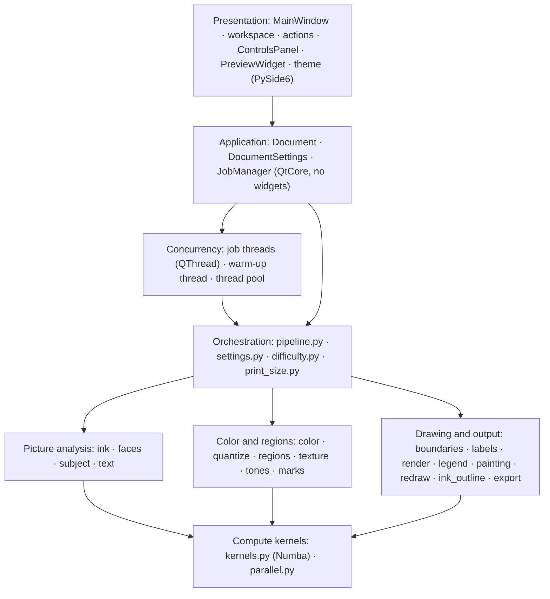

# Architecture

## Layers



The core (`src/tessellatum/core/`) never imports the GUI or Qt: the pipeline is a plain function of an image and three
settings objects, which is what lets the tests and the benchmark harness call it directly. All work runs off the UI
thread. The application layer (`src/tessellatum/app/`) holds what the user edits, apart from any widget, so it is
tested without a window.

## Repository

```
src/tessellatum/
  main.py          entry point
  core/            the pipeline: 29 modules
  app/             the document and its settings snapshot (QtCore only)
  gui/             the Qt interface: 6 modules, and theme/ (tokens, style, icons, motion)
  resources/       the four bundled models and their licenses (MODELS.md); fonts/ (Inter, OFL) and icons/
                   (Lucide, ISC); the logo (logo.svg, logo-small.svg) and the app's icons rendered from it
                   (app-icon/ 16-512 px, icon.ico, icon.icns, icon.png)
tests/             pytest suite and the benchmark images (CC0 / public domain)
benchmarks/        speed and quality harness, quality spec and report
packaging/         PyInstaller spec and build scripts
docs/              README images and the scripts that regenerate them
wiki/              these pages (published to the GitHub wiki on every push to main)
```

## Main modules

| Module | Role |
|---|---|
| `core/pipeline.py` | Orchestration: working size, stage cache, the full generation, drawing a page at print size |
| `core/settings.py`, `core/difficulty.py` | The settings registry: every user setting, slider or choice, with its range, default and description; the five presets |
| `core/print_size.py` | The print model: A4, A3 and A2 geometry, pixels per millimetre, unit conversions |
| `core/quantize.py`, `core/color.py` | Bilateral filter, k-means palette, CIEDE2000 merge, a palette from the painter's paints and the colors they mix; exact color conversion |
| `core/paints.py`, `core/paint_kits.py` | The painter's paints: read from text and from palette files; generic sample kits to start from |
| `core/mixing.py`, `spectral_data.py` | Mixing recipes and a palette's two-paint mixes by Kubelka-Munk theory over reflectance curves; spectral.js's data (MIT) |
| `core/ink.py`, `faces.py`, `subject.py`, `text.py` | Line-art decision and ink; the three detectors; lettering |
| `core/regions.py`, `texture.py`, `tones.py`, `marks.py` | Regions, brush rule, line-art regions; edge vote; face tones and marks |
| `core/boundaries.py`, `labels.py`, `render.py` | One line per boundary; number placement; page rendering |
| `core/painting.py`, `legend.py`, `color_names.py`, `redraw.py`, `export.py`, `swatches.py` | Painted versions; legend and its color names; print-size redraw; PNG and PDF; palette files |
| `core/kernels.py`, `parallel.py` | Numba-compiled pixel loops; the shared thread pool |
| `app/snapshot.py`, `app/document.py` | `DocumentSettings`, every setting as one immutable value; `Document`, the picture, its settings and the page made of them |
| `app/presets.py` | `PresetStore`: presets of one's own, the difficulty's settings by name, in a versioned JSON file in the preferences folder; a file that can't be read is left out with a warning and kept aside |
| `app/history.py` | `History`: undo and redo on a `QUndoStack`, each change keeping the settings (or the picture) before and after it whole; the edits made in one go and a slider's drag are one step; the clean state for saving |
| `app/jobs.py` | `JobManager` and `Job`: every background step, its identity, and the checks on its result |
| `app/project.py` | Project files: a zip of a manifest (format version, settings by registry name, paints, export options, the picture's name, size and SHA-256), the picture's original bytes and a thumbnail; atomic save (temporary file beside it, read back, `os.replace`); reading in memory with member names, sizes, JSON and the picture all checked; migration of older versions and a clear refusal of newer ones |
| `app/recovery.py` | Recovery: a session per window, locked with a `QLockFile` while it runs; its unsaved work written atomically as a project plus a small JSON note to the app's data folder; snapshots of sessions whose lock is free (the process gone) offered at the start, then discarded or pruned (age, count) |
| `app/results.py` | `ResultCache`: the pages made (and their print layouts), by the picture's content hash, the settings' generation key and the pipeline's version, within a memory budget measured from their buffers; the page shown and its undo and redo neighbors protected |
| `gui/actions.py` | Every command as one `QAction`: text, icon, shortcut, menu |
| `gui/main_window.py`, `workspace.py` | The window: toolbar, activity bar, sidebar, canvas and inspector in a splitter; focus mode, reflow, the layout kept between runs |
| `gui/palette_inspector.py`, `core/measures.py` | The palette inspector: the legend's colors in a list or grid, sorted without renumbering, found by number or name, copied; the coverage per color, measured off the GUI thread by an inspection job from the region map (`measures.color_coverage`: pixels and regions per color, summing to the painted area); the color picked highlighted in the canvas's annotation layer. `core/measures.py` depends on NumPy and OpenCV alone, so the benchmark loads it by its path (as it loads `print_size.py`): the slivers, corners' tips, undersized and unnumbered regions and the numbers' sizes the benchmark scores are the functions the Analysis page shows, one implementation |
| `gui/analysis.py` | The Analysis page of the sidebar (`ControlsPanel.add_page`, a page that isn't settings): `measures.measure_page` run by an analysis job while the page is open, once a page; its measures, its issues (regions to pick, through the region inspector), and overlays drawn in the canvas's diagnostics layer, off until asked for |
| `gui/region_inspector.py` | The region inspector, under the palette: a click maps the canvas's page point to the region map's pixel (any view, since every view is laid over the page's pixels); the region's measures on paper from `measures.region_stats` (every region's area and box, in one pass, measured with the coverage by the inspection job) and `widest_brush_px` (a distance transform of the region's box alone); its number from the page's labels; the region outlined over its box alone, so a pick builds no page-sized image. A pick is kept across a page whose region map is equal, else dropped |
| `gui/fields.py` | The fields a setting is edited in, built from its registry entry: slider and exact entry (locale numbers, inline range errors, keyboard steps), millimetres or inches with the value kept in millimetres, the changed-value marker and its reset, the reason it is off, drag start and end for undo; the segmented control for two to four choices |
| `gui/status.py`, `notifications.py` | The status bar (state, progress, the page's figures, the zoom); the notifications over the page and the diagnostics log, which records each job as it ends and the app's own warnings and errors from any thread |
| `gui/preferences.py` | `Preferences` (global, in the window's `QSettings` under `preferences/`, outside the document and its undo) and the Preferences dialog; the interface scale is applied by `main` through `QT_SCALE_FACTOR` before the application exists |
| `gui/welcome.py` | The welcome page shown in the canvas while no picture is open: open buttons, the bundled examples (`resources/examples/`, each credited in its `README.md`), the recent projects and pictures (missing ones greyed, with Remove); the window takes drops and pastes itself (`_handed_over`: local file URLs, image data, a path pasted as text) |
| `gui/accessibility.py`, `gui/vision.py` | What Qt doesn't do on its own for the keyboard and screen readers: a control focused inside a scroll area is scrolled into view (on `QApplication.focusChanged`, however the focus came), the scroll areas around controls are no Tab stop, and the parts Qt makes (overflow and clear buttons) get names. The color-vision simulation: a 3×3 matrix on linear RGB per deficiency, applied by the canvas to the pixels it shows after scaling (part of the key of what it shows), never to the page's images |
| `gui/shortcuts.py` | The keyboard reference (Help > Keyboard Shortcuts, and the Preferences' Shortcuts page): built from the window's `QAction`s, each with its menu (the action's `menu` property), in the platform's notation, plus the keys that work in one widget; searched in shown and portable notation. A widget that uses Esc itself (a field, the settings search, the palette, the region list) accepts its `ShortcutOverride`, so Cancel's Esc doesn't take it while a page is made |
| `gui/search.py` | Settings search: the registry's entries ranked against what is typed (label, aliases, tooltip, section), and the field and results at the top of the sidebar; the panel's `reveal` shows a setting where it lives |
| `gui/export_dialog.py` | The export dialog: the export's options beside a thumbnail and a summary of the file, non-blocking warnings, and the choice between the page made again and the page as previewed when the preview is out of date |
| `gui/controls_panel.py`, `preview_widget.py`, `paints_dialog.py` | The settings sidebar (a page per category, laid out by the registry's sections and levels: the advanced settings in one folded group per page; a reset per section), the canvas (the views, the original mapped onto the page's pixels; zoom and pan; the rulers, grid and sheet bounds; the
scene in layers: artwork, guides, annotation, diagnostics, interaction, each drawn over the ones below so a highlight
never draws the page again, and none of them but the artwork from the page's own data, which exports never read), the comparison (a second canvas side by side, sharing the first's images and following its zoom and scroll, or a view drawn over the page clipped to one side of a divider; the previous version looked up with `ResultCache.peek`, which counts no hit and reorders nothing), the paints' list (swatches, a color picker, sample kits) |

## Data model

- **Settings:** three frozen dataclasses, `DifficultyParams` (how granular), `PageStyle` (how lines and numbers print)
  and `Handling` (what is done with line art, faces and text). Being hashable, they key the stage cache, and the GUI
  compares them to decide whether an export can reuse the preview.
- **Result:** `GeneratedPage`, holding the page and legend images plus three descriptions of how the page was made:
  `PageModel` (region map, colors, ink, strokes and numbers, to redraw it at print size), `PageDrawing` (its geometry,
  for the vector PDF) and `Painting` (which paint goes where, for the painted versions).

- **Document.** `DocumentSettings` holds every setting the panel shows (the preset, each slider's value, tone,
  paper, medium, legend, paints, switches, export options) as one frozen, comparable value, and works out the three
  pipeline objects from it. The panel announces each edit as a new snapshot; the window's `Document` keeps it with a
  revision count, the picture (with a content hash worked out off the GUI thread) and the page made of it, with the
  settings it was made with, so it knows whether the page is still what the settings would make: the legend and the
  export options don't count, as changing them doesn't make the page again.
- **Settings registry.** `core/settings.py` describes every setting once, Qt-free: the 30 sliders (`Setting`: the
  pipeline field it sets, range, step, unit) and the 11 choices (`Choice`: the difficulty, paper, Coloring on, Colors
  from, paints, mixing, tone, legend and the three handling switches), each with its category and section, level
  (intent, precise, advanced), unit kind, aliases for search, update policy (`update_policy`: the legend applies at
  once; the page's style but for its paper, the lines, numbers and tone, a moment after the last change, as the stage
  cache keeps the regions and only the drawing runs again; the rest with Generate, or a second after the last change
  if Preferences > Generate automatically says so: always, or while the picture's last page made afresh took under
  2 s, timed from its job), an enablement predicate over the document's choices that returns the reason to show, and its
  persistence key (unchanged from earlier versions). Validation (`check`) refuses a value with a reason and never
  clamps. Tests check that every field of `DifficultyParams`, `PageStyle` and `Handling` is covered once (two
  internal fields named as such), that the presets' values match `difficulty.py`, that every entry has a control in
  the panel, and that a settings file written by earlier versions loads.
- **Commands.** `gui/actions.py` defines each command once; the window builds the menu bar from it, the panel's
  buttons trigger the same `QAction`s, and each action is enabled with its button.

## Runtime

- **Jobs.** The UI thread never runs the pipeline. Every slow step is a `Job` run by the window's `JobManager`
  (`app/jobs.py`) on a thread of its own: the preview (with its three versions), the preview laid out at print size
  (for the zoom and the export), a page made afresh to export, writing the file (the PDF, the PNG drawn in pixels with
  QtPdf, a palette; not cancellable), and the legend's recipes. A job records the document's revision, picture and
  settings when it starts; its task gets a progress callback and a cancel flag and never touches a widget. Its outcome
  comes back through a queued signal and is checked on the GUI thread: it is delivered only if the job is still the
  newest of its kind, wasn't cancelled, and is of the picture the document still holds (plus the job's own check,
  such as "the print layout is of the preview still shown"). A result made while a setting changed is delivered with
  the settings it was made with, so the document knows it is out of date. One job of each kind runs at a time: a new
  one cancels the last and starts when it has stopped, so two jobs never compute the same stage side by side.
  A task's progress callback (`jobs.Progress`) also takes the pipeline's stages (`progress.stage(event)`, passed to
  `generate`'s `stage_callback`): the manager passes them on for the current job (the status bar says "Choosing the
  colors… 42%"), and the job keeps the ones done, with their times and whether they were kept, for the diagnostics.
  A job asked to stop records when, so the log says how long it took. Failures keep their traceback and exception
  class; `app/errors.py` says them in words that say what to try (memory: a smaller paper, an easier difficulty, a
  lower resolution; a file: open elsewhere, a full disk, a missing folder). Closing the window cancels every job without waiting; the threads aren't children of
  the window, and the application waits for them, bounded, when it quits. Tests drive the manager with tasks they
  hold and release (`tests/test_jobs.py`).
- **Other threads.** A warm-up thread compiles the kernels at start-up (a failure is logged); a shared thread pool
  runs row stripes and per-region work in parallel, which is effective because OpenCV, NumPy and every Numba kernel
  release the GIL.
- **Cancellation.** Cooperative: the pipeline polls a cancel flag between stages and between numbers.
- **Caching.** A per-image stage cache (a weak reference to the image, LRU, 9 entries per page kept, 2 pages by
  default, set in Preferences) keeps resizes, detections, palettes and the region stage's output. The regions are
  keyed by the page's size, the difficulty, the handling and the paper, and by nothing else the style says, so a change
  to the lines or numbers draws the page again from the regions kept (on line art, the regions merged for want of room
  for a number are merged again, after the cache). Their arrays are read-only, so nothing downstream can change a kept
  result; generation is deterministic, which the keys rely on, and tests check a page drawn from kept regions against
  one drawn from scratch, pixel for pixel (`tests/test_stage_cache.py`).
- **Result cache.** Whole pages are kept as well, in `app/results.py`, under a key of three parts: the picture's
  content hash, so the same pixels find their pages however they were opened; the settings' generation key, the
  pipeline's own settings objects, so the legend's detail and the export options are left out and equal settings
  however reached share a key; and the pipeline's version, the app's plus a hash of the model files. Generation is
  deterministic, so a key always stands for one page. Each entry is measured from its arrays and images. Least
  recently used entries go first once over the budget (Automatic: a quarter of RAM, at most 2 GB), except the page
  shown and the pages its undo and redo go to, which are protected. A page put in is made read-only, since everyone
  who shows, exports or restores it shares it. The window looks a key up on every change to the settings and on every
  undo or redo: a hit is shown without a job (about 0.1 s), and a miss for a state that had a page is made again in the
  background. The history keeps settings and pictures, never pages (`tests/test_results.py`).
- **Progress.** Each stage reports its measured share of the work, so the progress bar is real; with a
  `stage_callback`, the pipeline also announces each stage by name as it starts and ends (`StageEvent`), with how
  long it took and whether the stage cache had it.

## Theme

`gui/theme/` gives the interface its look, separately from what it shows:

- **Tokens** (`tokens.py`): every color, size and duration, as a light and a dark set of the same names (surfaces,
  text, borders, the Viridian accent, states, status colors), plus the type scale, spacing, radii, icon sizes and
  motion durations. `CONTRAST_PAIRS` lists every text/surface and boundary/surface pairing the interface draws, and
  a test checks each against WCAG AA (4.5:1 for text, 3:1 for boundaries) in both schemes.
- **Style** (`style.py`): a `QPalette` and one application stylesheet built from the tokens, on Qt's Fusion style
  on every platform; native file and color dialogs and window frames stay the system's. Widgets carry object names
  and roles (`sectionHeader`, `role="hint"`, `primary`), never colors: a widget's own stylesheet would freeze its
  colors through a theme switch.
- **ThemeManager** (`__init__.py`): follows `QStyleHints.colorScheme` live, or the user's Light/Dark choice (kept in
  `QSettings` under `appearance/theme`), and re-applies the palette and stylesheet on every change. It also reads
  the system's reduced-motion setting (Windows, macOS, GNOME), with an override, so animations can be skipped.
- **Icons** (`icons.py`): Lucide SVGs recolored from `currentColor` to a token's color per state (normal, selected,
  disabled), cached per size and pixel ratio; stylesheet arrows are recolored copies in a temporary folder.

The page, its versions and its legend are never themed: the canvas shows their own pixels.

## Packaging

`pyproject.toml` declares the package and its dependencies (PySide6, OpenCV, NumPy, Pillow, Numba, ONNX Runtime).
PyInstaller builds a standalone "onedir" app from `packaging/tessellatum.spec`, bundling the models, the font and
the icons (the self-test checks the last two are there, and the app's icons). The app's icons are rendered from the
logo's two SVG masters by `packaging/icons/make_icons.py` (the masters themselves by `make_logo.py`, from the
geometry and colors in it): the 16 to 24 px sizes from the simplified master, the larger from the full one, each size
drawn for itself in the Windows `.ico`, the macOS `.icns` and the window icon. A test checks the committed icons are
what the masters render. The release
workflow builds it on GitHub Actions for every version tag (see [Development](Development)).
