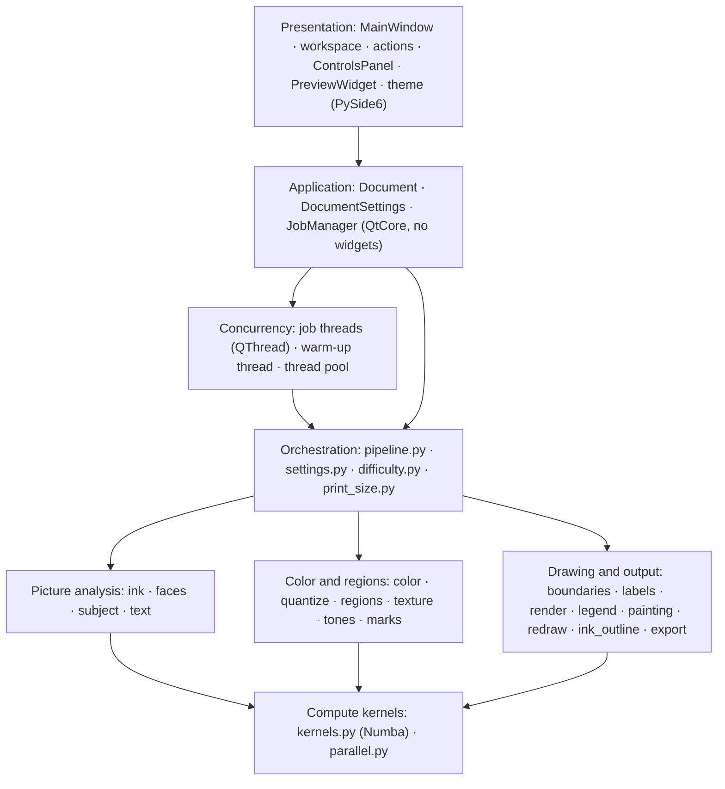

# Architecture

## Layers



The core (`src/tessellatum/core/`) never imports the GUI or Qt: the pipeline is a plain function of an image and three
settings objects, which is what lets the tests and the benchmark harness call it directly. All work runs off the UI
thread. The application layer (`src/tessellatum/app/`) holds what the user edits, apart from any widget, so it is
tested without a window.

## Repository

```
src/tessellatum/
  main.py          entry point
  core/            the pipeline: 29 modules
  app/             the document and its settings snapshot (QtCore only)
  gui/             the Qt interface: 6 modules, and theme/ (tokens, style, icons, motion)
  resources/       the four bundled models and their licenses (MODELS.md); fonts/ (Inter, OFL) and icons/
                   (Lucide, ISC); the logo (logo.svg, logo-small.svg) and the app's icons rendered from it
                   (app-icon/ 16-512 px, icon.ico, icon.icns, icon.png)
tests/             pytest suite and the benchmark images (CC0 / public domain)
benchmarks/        speed and quality harness, quality spec and report
packaging/         PyInstaller spec and build scripts
docs/              README images and the scripts that regenerate them
wiki/              these pages (published to the GitHub wiki on every push to main)
```

## Main modules

| Module | Role |
|---|---|
| `core/pipeline.py` | Orchestration: working size, stage cache, the full generation, drawing a page at print size |
| `core/settings.py`, `core/difficulty.py` | The settings registry: every user setting, slider or choice, with its range, default and description; the five presets |
| `core/print_size.py` | The print model: A4, A3 and A2 geometry, pixels per millimetre, unit conversions |
| `core/quantize.py`, `core/color.py` | Bilateral filter, k-means palette, CIEDE2000 merge, a palette from the painter's paints and the colors they mix; exact color conversion |
| `core/paints.py`, `core/paint_kits.py` | The painter's paints: read from text and from palette files; generic sample kits to start from |
| `core/mixing.py`, `spectral_data.py` | Mixing recipes and a palette's two-paint mixes by Kubelka-Munk theory over reflectance curves; spectral.js's data (MIT) |
| `core/ink.py`, `faces.py`, `subject.py`, `text.py` | Line-art decision and ink; the three detectors; lettering |
| `core/regions.py`, `texture.py`, `tones.py`, `marks.py` | Regions, brush rule, line-art regions; edge vote; face tones and marks |
| `core/boundaries.py`, `labels.py`, `render.py` | One line per boundary; number placement; page rendering |
| `core/painting.py`, `legend.py`, `color_names.py`, `redraw.py`, `export.py`, `swatches.py` | Painted versions; legend and its color names; print-size redraw; PNG and PDF; palette files |
| `core/kernels.py`, `parallel.py` | Numba-compiled pixel loops; the shared thread pool |
| `app/snapshot.py`, `app/document.py` | `DocumentSettings`, every setting as one immutable value; `Document`, the picture, its settings and the page made of them |
| `app/history.py` | `History`: undo and redo on a `QUndoStack`, each change keeping the settings (or the picture) before and after it whole; the edits made in one go and a slider's drag are one step; the clean state for saving |
| `app/jobs.py` | `JobManager` and `Job`: every background step, its identity, and the checks on its result |
| `gui/actions.py` | Every command as one `QAction`: text, icon, shortcut, menu |
| `gui/main_window.py`, `workspace.py` | The window: toolbar, activity bar, sidebar, canvas and inspector in a splitter; focus mode, reflow, the layout kept between runs |
| `gui/fields.py` | The fields a setting is edited in, built from its registry entry: slider and exact entry (locale numbers, inline range errors, keyboard steps), millimetres or inches with the value kept in millimetres, the changed-value marker and its reset, the reason it is off, drag start and end for undo; the segmented control for two to four choices |
| `gui/status.py`, `notifications.py` | The status bar (state, progress, the page's figures, the zoom); the notifications over the page and the diagnostics log, which records each job as it ends and the app's own warnings and errors from any thread |
| `gui/search.py` | Settings search: the registry's entries ranked against what is typed (label, aliases, tooltip, section), and the field and results at the top of the sidebar; the panel's `reveal` shows a setting where it lives |
| `gui/export_dialog.py` | The export dialog: the export's options beside a thumbnail and a summary of the file, non-blocking warnings, and the choice between the page made again and the page as previewed when the preview is out of date |
| `gui/controls_panel.py`, `preview_widget.py`, `paints_dialog.py` | The settings sidebar (a page per category, laid out by the registry's sections and levels: the advanced settings in one folded group per page; a reset per section), the zoomable preview, the paints' list (swatches, a color picker, sample kits) |

## Data model

- **Settings:** three frozen dataclasses, `DifficultyParams` (how granular), `PageStyle` (how lines and numbers print)
  and `Handling` (what is done with line art, faces and text). Being hashable, they key the stage cache, and the GUI
  compares them to decide whether an export can reuse the preview.
- **Result:** `GeneratedPage`, holding the page and legend images plus three descriptions of how the page was made:
  `PageModel` (region map, colors, ink, strokes and numbers, to redraw it at print size), `PageDrawing` (its geometry,
  for the vector PDF) and `Painting` (which paint goes where, for the painted versions).

- **Document.** `DocumentSettings` holds every setting the panel shows (the preset, each slider's value, tone,
  paper, medium, legend, paints, switches, export options) as one frozen, comparable value, and works out the three
  pipeline objects from it. The panel announces each edit as a new snapshot; the window's `Document` keeps it with a
  revision count, the picture (with a content hash worked out off the GUI thread) and the page made of it, with the
  settings it was made with, so it knows whether the page is still what the settings would make: the legend and the
  export options don't count, as changing them doesn't make the page again.
- **Settings registry.** `core/settings.py` describes every setting once, Qt-free: the 30 sliders (`Setting`: the
  pipeline field it sets, range, step, unit) and the 11 choices (`Choice`: the difficulty, paper, Coloring on, Colors
  from, paints, mixing, tone, legend and the three handling switches), each with its category and section, level
  (intent, precise, advanced), unit kind, aliases for search, update policy (only the legend applies at once; the
  rest with Generate), an enablement predicate over the document's choices that returns the reason to show, and its
  persistence key (unchanged from earlier versions). Validation (`check`) refuses a value with a reason and never
  clamps. Tests check that every field of `DifficultyParams`, `PageStyle` and `Handling` is covered once (two
  internal fields named as such), that the presets' values match `difficulty.py`, that every entry has a control in
  the panel, and that a settings file written by earlier versions loads.
- **Commands.** `gui/actions.py` defines each command once; the window builds the menu bar from it, the panel's
  buttons trigger the same `QAction`s, and each action is enabled with its button.

## Runtime

- **Jobs.** The UI thread never runs the pipeline. Every slow step is a `Job` run by the window's `JobManager`
  (`app/jobs.py`) on a thread of its own: the preview (with its three versions), the preview laid out at print size
  (for the zoom and the export), a page made afresh to export, writing the file (the PDF, the PNG drawn in pixels with
  QtPdf, a palette; not cancellable), and the legend's recipes. A job records the document's revision, picture and
  settings when it starts; its task gets a progress callback and a cancel flag and never touches a widget. Its outcome
  comes back through a queued signal and is checked on the GUI thread: it is delivered only if the job is still the
  newest of its kind, wasn't cancelled, and is of the picture the document still holds (plus the job's own check,
  such as "the print layout is of the preview still shown"). A result made while a setting changed is delivered with
  the settings it was made with, so the document knows it is out of date. One job of each kind runs at a time: a new
  one cancels the last and starts when it has stopped, so two jobs never compute the same stage side by side.
  Failures keep their traceback. Closing the window cancels every job without waiting; the threads aren't children of
  the window, and the application waits for them, bounded, when it quits. Tests drive the manager with tasks they
  hold and release (`tests/test_jobs.py`).
- **Other threads.** A warm-up thread compiles the kernels at start-up (a failure is logged); a shared thread pool
  runs row stripes and per-region work in parallel, which is effective because OpenCV, NumPy and every Numba kernel
  release the GIL.
- **Cancellation.** Cooperative: the pipeline polls a cancel flag between stages and between numbers.
- **Caching.** A per-image stage cache (a weak reference to the image, 16 entries, LRU) keeps resizes, detections and
  palettes, so changing only a later setting skips straight to the region stages.
- **Progress.** Each stage reports its measured share of the work, so the progress bar is real.

## Theme

`gui/theme/` gives the interface its look, separately from what it shows:

- **Tokens** (`tokens.py`): every color, size and duration, as a light and a dark set of the same names (surfaces,
  text, borders, the Viridian accent, states, status colors), plus the type scale, spacing, radii, icon sizes and
  motion durations. `CONTRAST_PAIRS` lists every text/surface and boundary/surface pairing the interface draws, and
  a test checks each against WCAG AA (4.5:1 for text, 3:1 for boundaries) in both schemes.
- **Style** (`style.py`): a `QPalette` and one application stylesheet built from the tokens, on Qt's Fusion style
  on every platform; native file and color dialogs and window frames stay the system's. Widgets carry object names
  and roles (`sectionHeader`, `role="hint"`, `primary`), never colors: a widget's own stylesheet would freeze its
  colors through a theme switch.
- **ThemeManager** (`__init__.py`): follows `QStyleHints.colorScheme` live, or the user's Light/Dark choice (kept in
  `QSettings` under `appearance/theme`), and re-applies the palette and stylesheet on every change. It also reads
  the system's reduced-motion setting (Windows, macOS, GNOME), with an override, so animations can be skipped.
- **Icons** (`icons.py`): Lucide SVGs recolored from `currentColor` to a token's color per state (normal, selected,
  disabled), cached per size and pixel ratio; stylesheet arrows are recolored copies in a temporary folder.

The page, its versions and its legend are never themed: the canvas shows their own pixels.

## Packaging

`pyproject.toml` declares the package and its dependencies (PySide6, OpenCV, NumPy, Pillow, Numba, ONNX Runtime).
PyInstaller builds a standalone "onedir" app from `packaging/tessellatum.spec`, bundling the models, the font and
the icons (the self-test checks the last two are there, and the app's icons). The app's icons are rendered from the
logo's two SVG masters by `packaging/icons/make_icons.py` (the masters themselves by `make_logo.py`, from the
geometry and colors in it): the 16 to 24 px sizes from the simplified master, the larger from the full one, each size
drawn for itself in the Windows `.ico`, the macOS `.icns` and the window icon. A test checks the committed icons are
what the masters render. The release
workflow builds it on GitHub Actions for every version tag (see [Development](Development)).
