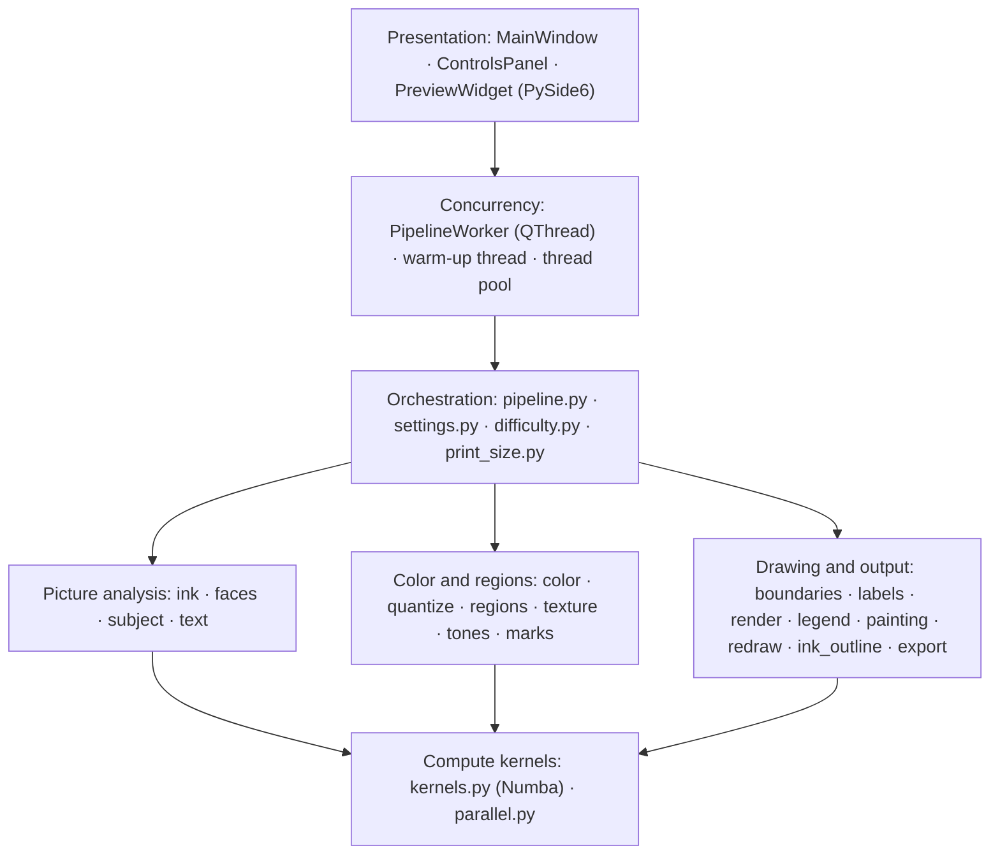

# Architecture

## Layers



The core (`src/tessellatum/core/`) never imports the GUI or Qt: the pipeline is a plain function of an image and three
settings objects, which is what lets the tests and the benchmark harness call it directly. All work runs off the UI
thread.

## Repository

```
src/tessellatum/
  main.py          entry point
  core/            the pipeline: 24 modules
  gui/             the Qt interface: 4 modules
  resources/       the four bundled models and their licenses (MODELS.md)
tests/             pytest suite and the benchmark images (CC0 / public domain)
benchmarks/        speed and quality harness, quality spec and report
packaging/         PyInstaller spec and build scripts
docs/              README images and the scripts that regenerate them
wiki/              these pages (published to the GitHub wiki on every push to main)
```

## Main modules

| Module | Role |
|---|---|
| `core/pipeline.py` | Orchestration: working size, stage cache, the full generation, drawing a page at print size |
| `core/settings.py`, `core/difficulty.py` | Every user setting with its range and default; the five presets |
| `core/print_size.py` | The print model: A4 geometry, pixels per millimetre, unit conversions |
| `core/quantize.py`, `core/color.py` | Bilateral filter, k-means palette, CIEDE2000 merge; exact color conversion |
| `core/ink.py`, `faces.py`, `subject.py`, `text.py` | Line-art decision and ink; the three detectors; lettering |
| `core/regions.py`, `texture.py`, `tones.py`, `marks.py` | Regions, brush rule, line-art regions; edge vote; face tones and marks |
| `core/boundaries.py`, `labels.py`, `render.py` | One line per boundary; number placement; page rendering |
| `core/painting.py`, `legend.py`, `redraw.py`, `export.py` | Painted versions; legend; print-size redraw; PNG and PDF |
| `core/kernels.py`, `parallel.py` | Numba-compiled pixel loops; the shared thread pool |
| `gui/main_window.py`, `controls_panel.py`, `preview_widget.py`, `worker.py` | Window, settings panel, zoomable preview, background worker |

## Data model

- **Settings:** three frozen dataclasses, `DifficultyParams` (how granular), `PageStyle` (how lines and numbers print)
  and `Handling` (what is done with line art, faces and text). Being hashable, they key the stage cache, and the GUI
  compares them to decide whether an export can reuse the preview.
- **Result:** `GeneratedPage`, holding the page and legend images plus three descriptions of how the page was made:
  `PageModel` (region map, colors, ink, strokes and numbers, to redraw it at print size), `PageDrawing` (its geometry,
  for the vector PDF) and `Painting` (which paint goes where, for the painted versions).

## Runtime

- **Threads.** The UI thread never runs the pipeline. A `PipelineWorker` (`QThread`) runs each preview or export and
  reports progress and results through Qt signals; a second worker draws the preview's page at print size in the
  background for the zoom and the export; a warm-up thread compiles the kernels at start-up; a shared thread pool runs
  row stripes and per-region work in parallel, which is effective because OpenCV, NumPy and every Numba kernel release
  the GIL.
- **Cancellation.** Cooperative: the pipeline polls a cancel flag between stages and between numbers.
- **Caching.** A per-image stage cache (a weak reference to the image, 16 entries, LRU) keeps resizes, detections and
  palettes, so changing only a later setting skips straight to the region stages.
- **Progress.** Each stage reports its measured share of the work, so the progress bar is real.

## Packaging

`pyproject.toml` declares the package and its dependencies (PySide6, OpenCV, NumPy, Pillow, Numba, ONNX Runtime).
PyInstaller builds a standalone "onedir" app from `packaging/tessellatum.spec`, bundling the models. The release
workflow builds it on GitHub Actions for every version tag (see [Development](Development)).
