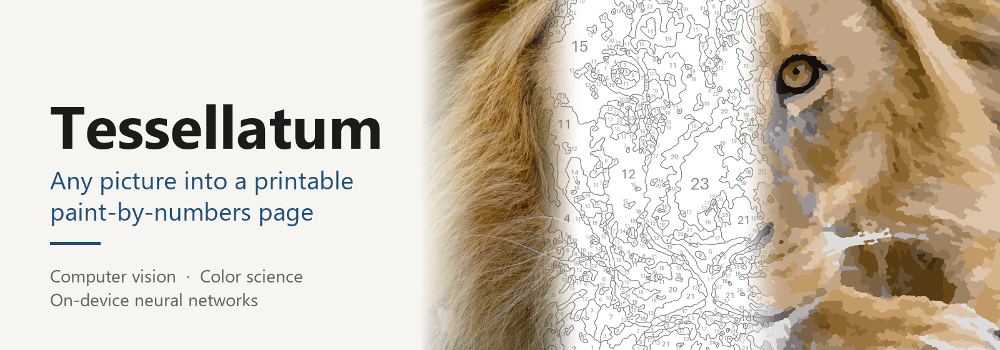

**Tessellatum** turns any picture into a paint-by-numbers (color-by-number) page, to print and fill with paints,
pencils or markers, or to color in your digital art app: flat, outlined regions, each numbered, and a color legend
that maps each number to a color. It is a native desktop app (Python, Qt 6) that runs entirely offline, including its
four small detection networks.

## Start here

- **[Getting started](Getting-Started)**: download, run from source, build a standalone app.
- **[User guide](User-Guide)**: the workspace, the difficulty levels, every setting, preview, projects and export.
- **[Settings reference](Settings-Reference)**: every setting's range, default, presets and when it applies.
- **[Gallery](Gallery)**: what it makes of photographs, paintings, cartoons and comics.

## How it is built

- **[How it works](How-It-Works)**: the pipeline, stage by stage, and why each stage is there.
- **[Techniques](Techniques)**: the machine-learning and image-analysis methods, by family.
- **[Architecture](Architecture)**: code organization, data model, threads and caching.
- **[Quality and performance](Quality-and-Performance)**: what a good page is, how it is measured, how fast it is.
- **[Development](Development)**: tests, benchmarks, versioning, releases and keeping these pages current.

## At a glance

| | |
|---|---|
| Input | Any image Pillow reads: photographs, paintings, cartoons, comics, scans |
| Output | Preview in three versions (page, painted, tinted guide), beside the picture itself; PNG at 150-600 dpi or any size up to 16,384 px; PDF of vector art; on A4, A3 or A2 |
| Perception | YuNet face detection, an LBP cascade for drawn faces, U²-Net salient objects, PP-OCR text detection |
| Construction | Bilateral filtering, k-means in CIELAB, CIEDE2000 merging, morphology, distance transforms, crack-graph boundaries |
| Speed | A preview in about 1–4 s (median over the benchmark images, by difficulty) |
| Verification | 2,000+ automated tests; a speed and quality benchmark across versions |
