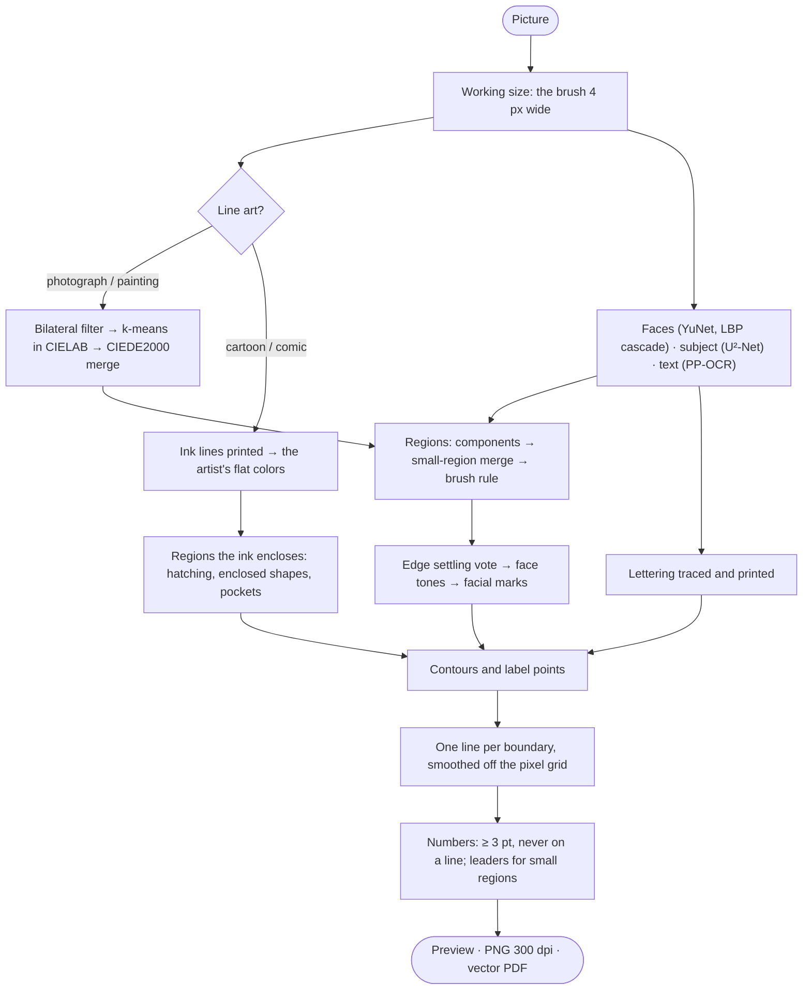

# How it works

Every page goes through the same pipeline (`src/tessellatum/core/pipeline.py`). It first decides whether the picture is
line art: if it is, the page is drawn from the artwork's own ink and fills. On a photograph or a painting, it looks for
faces and the picture's subject, which get smaller regions. On every picture it looks for lines of text, whose letters
are printed and kept free of numbers.

## The steps

1. **Quantize.** The image is smoothed with an edge-preserving bilateral filter and reduced to a small palette of flat
   colors by k-means clustering in CIELAB. Colors a painter could not tell apart or mix, closer than the color margin
   (4 ΔE00 at every level), are then merged into the color their pixels average to, so a photograph of fur or stone
   comes back with a handful of clearly different browns instead of twenty near-identical ones. That is why the legend
   can be shorter than the difficulty asked for.
2. **Regionize.** Same-color pixels are grouped into connected regions; regions smaller than the difficulty's
   threshold merge into the neighbor they share the most boundary with, and neighbors left sharing a color by that
   merge become one region, so the page never draws a line between two areas the painter fills alike.
3. **Widen (the brush rule).** Anything a brush cannot paint is given away. Every part of a region narrower than the
   brush (1 mm at Beginner to 0.5 mm at Realistic, on paper) goes to the region whose paint reaches it first, and a
   region thinner than that everywhere disappears into its neighbors, so the page asks for no stroke too fine to make.
   With the *sharpest corner* setting below 180°, a corner down to that angle keeps its point where the picture shows
   it plainly, and a triangle stays a triangle; the spikes of fur and foliage, which crowd within a brush's width of
   each other, are rounded off all the same.
4. **Settle.** Where a photograph is textured its colors alternate faster than a brush is wide, and the edges between
   regions come out ragged. So every pixel near an edge votes: it takes the color that holds the most of the page
   around it, weighted over about a brush's reach, with each color counting less the further it is from the pixel's own
   color in the picture. Where the picture has an edge of its own the pixels on each side suit their own color far
   better, and the edge stays on it; in fur, where they suit both alike, the edge runs smooth. The regions are then
   rebuilt by steps 2 and 3, so everything they promise still holds.
5. **Draw.** The boundaries between regions are traced from the region map along the cracks between pixels, and each is
   drawn once, as a single line its two regions share, so no boundary is doubled or left out. Each line is smoothed
   along its length to take the pixel staircase off it, but never by more than a pixel, so the page stays closed.
6. **Ink.** Lines go down as a round pen 0.2 mm across (by default), a size on paper, on a grid four times finer than the
   page and averaged back down, which anti-aliases them and lets them be thinner than a pixel. Lines and numbers print
   gray rather than black, so they vanish under the paint meant to cover them.
7. **Number.** Every region gets its number, never smaller than 3 pt on paper (nor than 10 px), and never where any of a
   line's ink falls. It goes at the region's most interior point if it fits there; otherwise wherever in the region it
   keeps farthest from the lines, made smaller if it has to be. A region too small even for that has its number written
   just outside it, with a leader line running to a dot inside it. No number goes within about 0.5 mm of a line of text.
8. **Print size.** A page is made once, at its working size, where its brush is 4 px across: about 1,100 px along a 3:2
   picture's long edge at Beginner up to 2,200 at Realistic. An export is that page drawn at 300 dpi from its own
   geometry: each region filled inside its smoothed outline, the lines scaled, the printed ink inside its own smoothed
   outline, the letters taken again from the picture at that size, and the numbers placed again. So an export always
   has its preview's regions, colors and legend.

## Line art

A cartoon or comic is flat fills with dark ink lines between them, and those lines are printed, not painted. The
pipeline tells such a picture from a photograph and finds its ink without being told its colors: a line is dark against
what lies beside it (a morphological closing estimates the paper around every pixel) and at most 5 mm wide on paper,
and a picture is line art when its fills are flat and deep lines cover enough of it. Its page is then drawn from its
ink:

- the ink is printed solid, in the artwork's own tone, and it is the line wherever it runs: no line is drawn beside it
  and no number goes on it;
- the colors are the fills' own, picked from a color histogram, never within the margin of a color already taken, so
  the legend offers the colors the artist chose rather than k-means averages;
- the regions are the areas the ink encloses. Hatching encloses nothing: the paint goes over ink thinner than 1.5 mm,
  so a hatched patch is one region in its own color, while bolder ink, an outline or a black shape, is never painted;
- a shape the ink encloses on its own, a finger or a button, keeps its number whatever the smallest region, as long as
  a brush fits in it; pockets a brush cannot reach against bold ink are left as bare paper.

## Faces and the subject

People notice a wrong face far more than a wrong patch of grass. Two small detectors ship with the app and run
offline: **YuNet**, a network for photographed and painted faces (trained on people, it finds a cat's or a lion's face
too), and **lbpcascade_animeface**, a cascade for drawn faces. A face narrower than 15 mm on paper is left out: its eyes
would be narrower than a brush.

On a photograph or painting, a region inside a face may be a quarter of the difficulty's smallest area, so eyes, a nose
or a mouth keep regions of their own. Thin dark marks that no brush could paint, such as pupils, the lines of eyelids
and lips, or the dots whiskers grow from, are printed instead, solid, as line art's ink is. A face's skin or fur is
settled into a few large tones: each region there takes the palette color nearest its own pixels, and joins a neighbor
wherever that changes its color by less than 1 ΔE00.

A page should also spend its detail on what the picture is of rather than the wall, sky or grass behind it. A third
network, **U²-Net-p**, looks at the whole picture and says where its salient object is; regions inside that subject may
be a quarter of the smallest area too. A picture with no one thing to look at, such as a crowded street, has little or
no subject.

## Text

Signs, titles and captions should still read on the page. A fourth network, **PP-OCRv6-small**'s text detector, run by
ONNX Runtime, finds the lines of text: first at half the preview's size, which finds lettering about 4 mm tall or more,
and where that finds any, again at twice that size from the source's own pixels, which finds small print down to about
1.7 mm. A picture without text pays only for the small first look.

The page prints the letters in each line found and nothing else in its box: the letters solid in the ink's tone, their
ground bare paper, whether they are darker than their ground or lighter. Which side of a line is its letters is told by
three cues, two of which must agree. The ground is found around every pixel with a morphological closing (or opening,
for light letters), so a gradient, a band or a glow behind the letters prints nothing; the letters' outline is traced
on a grid four times finer than the page, so the PDF prints it as smooth vector art.

For the methods behind each step, see [Techniques](Techniques); for the code, [Architecture](Architecture).
